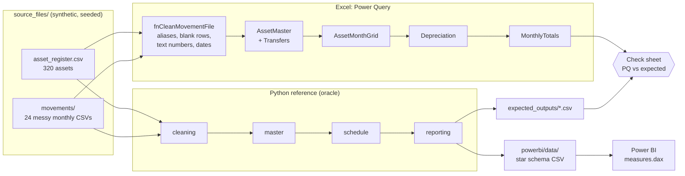
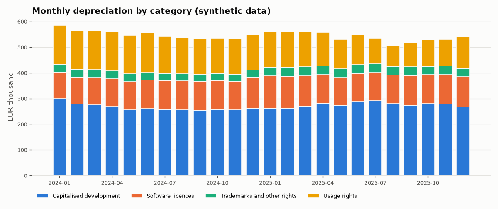
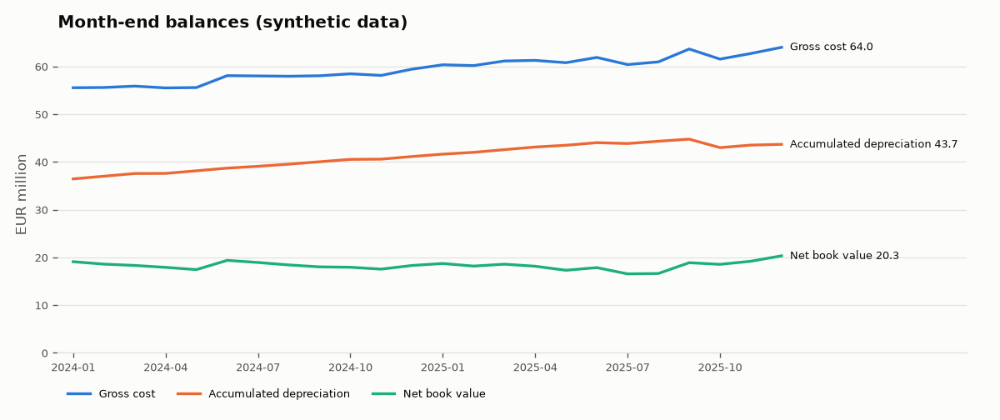

# Intangible-asset depreciation: Power Query model with a Python oracle

[](https://github.com/GerasimoskiDesign/excel-power-query-depreciation/actions/workflows/ci.yml)

This repo replaces a monthly depreciation report that was assembled by hand from many files. It has
Power Query (M) scripts that refresh with one click, an independent pandas implementation
that checks every number, and a star schema with DAX measures that is ready for Power BI.

*Rebuilt from scratch on synthetic data. The production version is proprietary.*

## The problem

The monthly depreciation report for intangible assets (software licences, capitalised
development, usage rights) was put together by hand. Someone copied an asset register
and a movement file for each month into one workbook, fixed each month's formatting,
and recalculated depreciation by hand. A missed disposal or a renamed column changed the numbers
without anyone noticing, and nobody could easily prove the totals were right.

## What this does

* **Power Query** (`powerquery/*.pq`, 14 queries with one step each) loads the folder of monthly files,
  cleans the formatting differences, combines the months, builds the asset x month grid and
  calculates straight-line depreciation. The first month is pro-rated by days, disposals stop depreciation,
  and the scripts produce accumulated depreciation and net book value (NBV).
* **The Python reference implementation** (`src/depreciation_model/`) follows the same
  [conventions](docs/CONVENTIONS.md) step for step. pytest checks it against hand-calculated cases,
  and it writes `expected_outputs/`, the totals that the Excel result must match.
* **`depreciation_model.xlsx`** (generated with openpyxl) holds the parameters, the source tables,
  the expected totals and a **Check** sheet. After a refresh, its formulas compare the Power Query output
  with the expected totals month by month.
* **Power BI-ready output**: a star schema as CSV (`powerbi/data/`) plus
  [`measures.dax`](powerbi/measures.dax) (Depreciation, Accumulated Depreciation, NBV,
  YoY change, Depreciation % of Cost).



## Results on synthetic data

All figures below are **synthetic**. They come from `python -m depreciation_model all` with seed 42,
reporting January 2024 to December 2025.

**Input:** 400 intangible assets (320 in the opening register and 80 added through the
monthly files), 30 disposals in the window (plus 12 disposed before it), and 25 cost-centre transfers. The
24 movement files come in 3 header layouts, 2 date formats and 2 number formats, with blank rows,
UTF-8 BOMs and inconsistent casing. The Python cleaner turns every one of the 24 files back into the generator's ground truth
(one test per file).

**Output:** 8,106 asset-month rows.

| Year | Depreciation | Gross cost (Dec) | Accumulated depreciation (Dec) | NBV (Dec) | Depreciation % of cost |
|------|-------------:|-----------------:|-------------------------------:|----------:|-----------------------:|
| 2024 | 6,594,199.75 | 59,425,915.81 | 41,124,357.84 | 18,301,557.97 | 11.10% |
| 2025 | 6,470,049.69 | 64,001,531.23 | 43,676,680.81 | 20,324,850.42 | 10.11% |

Year-on-year change in depreciation for 2025: **-124,150.07 (-1.88%)**. Over the two years, additions
were 16.47m and disposals at cost were 7.80m, with 2.56m of NBV written off on disposal. Of the 8,106
rows, 3,687 belong to fully depreciated assets that are still on the books at zero NBV.

Reconciliations that pass on every run (see `tests/test_reconciliation.py`):

| Check | Result |
|-------|--------|
| Every asset-month: opening + additions - disposals = closing (cost and accumulated depreciation) | difference < 0.000001 |
| Every month: closing balance = next month's opening balance | difference < 0.000001 |
| Monthly NBV roll-forward: opening NBV + additions - depreciation - NBV written off = closing NBV | difference < 0.000001 |
| Additions in the schedule = sum of ADDITION amounts in the 24 files | equal |
| No rows after an asset's disposal month; no depreciation after NBV reaches 0 | holds for all assets |





**Excel and Power BI.** The M scripts and the DAX measures have to run inside Excel and Power BI Desktop,
and CI cannot run them. The Check sheet logic is tested: pycel evaluates the formulas
for the "not loaded", "match" and "mismatch" cases. The repo does not yet include
a refreshed workbook or a report screenshot:

> TODO(Mario): screenshot of the Check sheet after Refresh All (`docs/img/excel_check_sheet.png`)
> and of the Power BI page (`docs/img/powerbi_report.png`). See [docs/LOAD_QUERIES.md](docs/LOAD_QUERIES.md)
> and [powerbi/README.md](powerbi/README.md).

## Production context

> _Production context: TODO(Mario) — what the real version did and its outcomes, using only publicly shareable facts._

## Quickstart

Requires Python 3.11+.

**Windows PowerShell**

```powershell
git clone https://github.com/GerasimoskiDesign/excel-power-query-depreciation.git
cd excel-power-query-depreciation
python -m venv .venv
.\.venv\Scripts\Activate.ps1
python -m pip install --upgrade pip
pip install -e ".[dev]"
python -m depreciation_model all      # data, expected outputs, star schema, workbook, charts
pytest
```

**macOS / Linux**

```bash
git clone https://github.com/GerasimoskiDesign/excel-power-query-depreciation.git
cd excel-power-query-depreciation
python3 -m venv .venv
source .venv/bin/activate
python -m pip install --upgrade pip
pip install -e ".[dev]"
python -m depreciation_model all
pytest
```

You can also run the steps one at a time: `generate`, `compute`, `workbook`, `charts`. Options:
`--seed 42`, `--as-of 2025-12` (last reporting month), `--months 24`, and
`--source-folder source_files` (writes the full path into the workbook parameter).
Optional defaults can go in `.env` (see `.env.example`).

Then follow [docs/LOAD_QUERIES.md](docs/LOAD_QUERIES.md) to paste the queries into Excel
(Windows, once), and [powerbi/README.md](powerbi/README.md) for the Power BI model.

## Project structure

```
excel-power-query-depreciation/
├── powerquery/                 # 14 M queries, numbered in load order
│   ├── 01_pSourceFolder.pq … 03_pReportMonths.pq   # parameters from named ranges
│   ├── 04_ColumnAliases.pq, 05_MovementTypeAliases.pq
│   ├── 06_fnCleanMovementFile.pq                   # one messy file -> clean table
│   ├── 07_AssetRegister.pq, 08_MovementsClean.pq   # load folder + combine
│   ├── 09_AssetMaster.pq, 10_Transfers.pq          # joins + validation
│   ├── 11_ReportMonths.pq, 12_AssetMonthGrid.pq    # asset x month grid
│   └── 13_Depreciation.pq, 14_MonthlyTotals.pq     # depreciation, roll-forward, totals
├── src/depreciation_model/     # Python reference implementation (the oracle)
│   ├── generate.py             # seeded synthetic register + messy monthly files
│   ├── cleaning.py             # mirrors fnCleanMovementFile
│   ├── master.py               # register + additions, disposals, transfers
│   ├── schedule.py             # closed-form straight-line depreciation
│   ├── reporting.py            # monthly totals, yearly measures, star schema
│   ├── workbook.py             # depreciation_model.xlsx with the Check sheet
│   ├── charts.py, dates.py, config.py, pipeline.py, cli.py
├── source_files/               # generated inputs (committed, ~100 KB)
├── expected_outputs/           # Python reference totals the Excel result must match
├── powerbi/                    # data/*.csv star schema, measures.dax, README
├── docs/                       # CONVENTIONS.md, LOAD_QUERIES.md, img/
├── tests/                      # pytest: conventions, cleaning, joins, reconciliation, M, Check sheet
├── depreciation_model.xlsx     # generated workbook (queries are pasted in by hand)
└── .github/workflows/ci.yml    # ruff + pytest + "committed outputs are reproducible"
```

## Design decisions & trade-offs

* **Two engines, one convention.** The Power Query scripts are what finance uses. The Python
  version exists only to prove them right. Both implement the rules in
  [docs/CONVENTIONS.md](docs/CONVENTIONS.md), and the Check sheet compares their monthly totals.
  Checking against an independent implementation catches errors that a formula audit misses.
* **Pro-rata by days, capped at cost.** The first month is charged from the acquisition day,
  the disposal month up to the day before disposal, and the remainder of the first month is charged in
  month `life + 1`. Many companies use a simpler rule (full month or no charge in the
  acquisition month). That is a policy choice: changing it touches one function in each engine.
* **Closed form instead of running totals.** Accumulated depreciation is
  `min(cost, cost x service months / life)`, computed for each row. In M this avoids slow,
  order-dependent running sums. Both engines evaluate the same expression in double precision, so
  any difference should come only from summation order, which is far below the 0.01 tolerance.
* **Fail loudly on bad inputs.** An unknown column or movement type, a duplicate addition, or a
  disposal of an unknown asset stops the refresh with the file and asset ids. A missing disposal is the
  worst kind of error here, because the asset quietly keeps depreciating.
* **Aliases in one place.** A new header spelling is one row in `04_ColumnAliases.pq` and one
  line in `config.py`. A test fails if the two lists differ.
* **The Check sheet compares fixed columns and also checks header names.** SUMIFS on fixed columns works in
  every Excel version and in pycel, which tests it. A header check (B5) catches a reordered query.
* **Balances are semi-additive in DAX.** Gross cost, accumulated depreciation and NBV take the
  last month in context. YoY shifts by `month_index` instead of `SAMEPERIODLASTYEAR`, so the
  month-grain date table works without being marked as a date table.
* **Limitations.**
  * The M code has been written and reviewed but not executed in CI (that needs Excel). It
    is verified only when someone refreshes it in Excel (TODO above).
  * The data covers one currency, no impairments, no revaluations, no changes to useful life,
    and no partial disposals.
  * Transfers move only the cost centre, never amounts between assets.
  * The movement files are CSV. Real exports are often `.xlsx`, which would need
    `Excel.Workbook` instead of `Csv.Document` in step 06.
* **What I'd do next.** Run the M scripts headless (for example through a Power BI dataflow or
  the Power Query SDK) so CI can compare M with Python directly. Add impairments and changes to
  useful life. Add a reconciliation page to the Power BI report.

## Tech stack

Power Query (M), Excel, DAX / Power BI, Python 3.11 (pandas, openpyxl, matplotlib),
pytest, pycel (evaluates the Excel Check formulas in tests), ruff, GitHub Actions.
