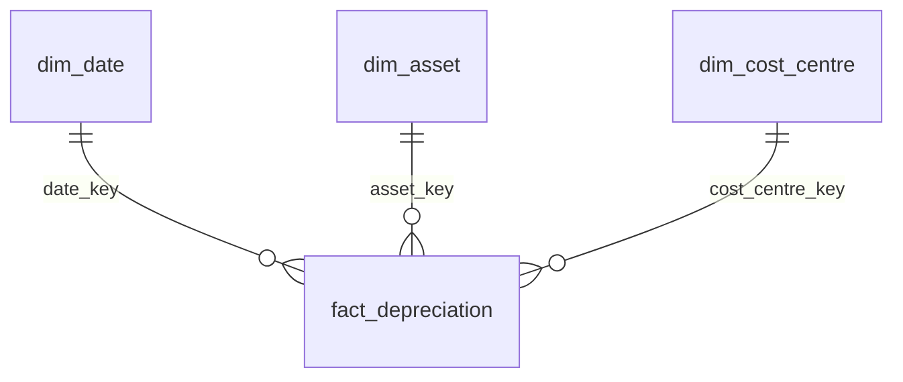

# Power BI: star schema and measures

`python -m depreciation_model compute` writes a star schema to `powerbi/data/`:

| Table | Grain | Key | Notes |
|-------|-------|-----|-------|
| `fact_depreciation` | asset x month (only months the asset is on the books) | `date_key` + `asset_key` | full roll-forward: opening/closing cost, accumulated depreciation, NBV, additions, disposals |
| `dim_asset` | asset | `asset_key` | category, cost, useful life, acquisition/disposal date, `initial_cost_centre` |
| `dim_date` | month | `date_key` (yyyymmdd of month start) | `month_index` = year x 12 + month - 1 (used by the YoY measures) |
| `dim_cost_centre` | cost centre | `cost_centre_key` | name and division |

The cost centre sits on the **fact**, not on `dim_asset`. Assets move between cost
centres (transfers), so each month row carries the cost centre that applied in that month.

## Build the report (Power BI Desktop)

> TODO(Mario): do this once in Power BI Desktop, save the report as
> `powerbi/depreciation.pbix` (optional, binary) and a screenshot as
> `docs/img/powerbi_report.png` (placeholder referenced in the README).

1. **Home > Get data > Text/CSV**. Load the four files in `powerbi/data/` one at a time
   (or use **Get data > Folder** and pick each file). In the preview, click **Load**.
   Check the column types in Power Query:
   * `month_start`, `month_end`, `acquisition_date`, `disposal_date`: **Date**
   * all amount columns: **Decimal number**
   * all `*_key` columns, `month_index`, `year`, `useful_life_months`: **Whole number**
2. **Model view**: Power BI usually detects the relationships. Check that you have exactly
   these three relationships (many-to-one, single direction, from the fact to the dimension):
   * `fact_depreciation[date_key]` -> `dim_date[date_key]`
   * `fact_depreciation[asset_key]` -> `dim_asset[asset_key]`
   * `fact_depreciation[cost_centre_key]` -> `dim_cost_centre[cost_centre_key]`
3. In `dim_date`, select `year_month` and **Sort by column** > `month_index`. Do the same
   for `month_name` (sort by `month_number`).
4. Hide the key columns and the raw amount columns of the fact from report view (users
   should work with the measures).
5. Select `fact_depreciation` > **New measure**. Paste each measure from
   [`measures.dax`](measures.dax) (one measure per paste, starting at the measure name).
   Put them in a display folder called *Depreciation*.
6. Suggested page:
   * Cards: Depreciation, NBV, Accumulated Depreciation, Depreciation YoY %
   * Clustered column chart: `dim_date[year_month]` x Depreciation, legend `dim_asset[category]`
   * Line chart: `dim_date[year_month]` x Gross Cost, Accumulated Depreciation, NBV
   * Matrix: `dim_cost_centre[cost_centre_name]` rows x `dim_date[year]` columns, value Depreciation
   * Slicers: `dim_date[year]`, `dim_asset[category]`, `dim_cost_centre[division]`

## Values to check the measures against

These come from the Python reference (`expected_outputs/yearly_measures.csv`, synthetic
data, seed 42). With a `dim_date[year]` slicer or a table by year, the measures must show:

| Measure | 2024 | 2025 |
|---------|-----:|-----:|
| Depreciation | 6,594,199.75 | 6,470,049.69 |
| Gross Cost (at Dec) | 59,425,915.81 | 64,001,531.23 |
| Accumulated Depreciation (at Dec) | 41,124,357.84 | 43,676,680.81 |
| NBV (at Dec) | 18,301,557.97 | 20,324,850.42 |
| Depreciation YoY Change | (blank) | -124,150.07 |
| Depreciation YoY % | (blank) | -1.88% |
| Depreciation % of Cost | 11.10% | 10.11% |

If **Gross Cost**, **Accumulated Depreciation** or **NBV** show much larger numbers for a
year, they are being summed over months. These are balances, and the measures take the
value at the last month in the filter context.
